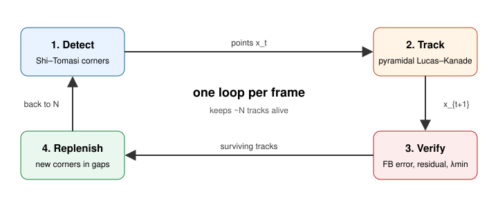

# Lab Notebook

## Contents

- [Chapter 0: Tracking problem](#chapter-0-tracking-problem)
- [Chapter 1: Optical flow](#chapter-1-optical-flow)
- [Chapter 2: Aperture and corners](#chapter-2-aperture-and-corners)
- [Chapter 3: Pyramids and checks](#chapter-3-pyramids-and-checks)
- [Chapter 4: Lucas–Kanade](#chapter-4-lucaskanade)
- [Chapter 5: KLT pipeline](#chapter-5-klt-pipeline)
- [Chapter 6: Applications](#chapter-6-applications)
- [Chapter 7: Debrief](#chapter-7-debrief)

---

## Chapter 0: Tracking problem

*Source: `0-tracking-problem.js` (chapter "boot")*

### The tracking problem

*Level: story*

A **feature tracker** takes a sequence of images and a set of points or regions in the first frame, and returns the locations of the set in every subsequent frame.

- **Input:** consecutive frames $I_k, I_{k+1}$ and point locations $\mathbf{x}_i$ in $I_k$.
- **Output:** new locations $\mathbf{x}_i + \mathbf{d}_i$ in $I_{k+1}$, additionally a flag saying whether the region is still eligible for tracking.

The **Kanade–Lucas–Tomasi (KLT)** tracker combines three ideas that the following chapters develop: local optical flow, iterative image alignment (Lucas & Kanade, 1981; Tomasi & Kanade, 1991), and choosing points that are *trackable* (Shi & Tomasi, 1994).

### Why not just match descriptors?

*Level: story*

Another way to follow points is to **detect and match** in every frame: find keypoints, describe each with a vector (SIFT, ORB, ...), and match vectors between frames.

KLT makes a different assumption: between two consecutive video frames, most points move only a few pixels. How far a point moves depends on the camera, its motion, object's motion (at the location of the point) and the point's depth. For a point at depth $Z$ near the image centre, seen by a camera with focal length $f$ (in pixels) translating sideways at speed $v_\perp$ and recording at a given frame rate,

$$\|\mathbf{d}\| \approx \frac{f\, v_\perp}{Z \cdot \text{fps}}.$$

For this robot ($f \approx 582$ px for a 960 px wide image with a 79° horizontal field of view, $v_\perp = 1.3$ m/s, 24 fps) a point 3 m away moves about 10 px between frames, and a point 1 m away about 30 px. Turning adds a further shift that is the same at every depth. Near points and sideways motion are the hard cases; distant points and points close to the direction of travel move least. So instead of searching the whole image, KLT starts at the old position and *slides* a small patch until it lines up. This gives three advantages:

- **Sub-pixel accuracy:** the computed distance can be a continuous shift such as 3.27 px.
- **No descriptors:** nothing to compute, store, or match.
- **Speed:** a few small linear solves per point. It can even run on microcontrollers.

On the other hand, when the motion is large or the image changes appearance, the assumption fails. (Chapter 3 deals with these cases.)

### Notation used throughout

*Level: math*

| Symbol | Meaning |
| --- | --- |
| $I(x, y, t)$ | image brightness at pixel $(x, y)$ and time $t$ |
| $I_k$ | the $k$-th video frame, $I_k(\mathbf{x}) = I(\mathbf{x}, t_k)$ |
| $\mathbf{x} = (x, y)^\top$ | a pixel location |
| $\nabla I = (I_x, I_y)^\top$ | spatial gradient, $I_x = \partial I / \partial x$ |
| $I_t$ | temporal derivative, in practice $I_{k+1}(\mathbf{x}) - I_k(\mathbf{x})$ |
| $\mathbf{d} = (u, v)^\top$ | displacement (flow) of a point between frames |
| $\mathcal{W}$ | a small window (patch) around a feature, e.g. $15 \times 15$ px |
| $T(\mathbf{x})$ | the template: the patch from the earlier frame |

Images are treated as continuous functions; derivatives are approximated with finite differences, and values between pixels with bilinear interpolation.

We write $\mathbf{d} = (u, v)$ for the flow of a point. When tracking is posed as image alignment (Chapter 4), the same displacement is called $\mathbf{p}$, the parameters of a warp. We call the sequence of positions of one point over time a track.

---

## Chapter 1: Optical flow

*Source: `1-optical-flow.js` (chapter "lobby")*

### The three assumptions

*Level: story*

Optical flow is the apparent motion of image brightness between consecutive frames. Estimating it relies on three assumptions:

1. **Brightness constancy**: a point looks the same in both frames (at a new location).
2. **Small motion**: the shift is small enough for the linear approximation.
3. **Spatial coherence**: all pixels in the window move together.

### Brightness constancy

*Level: story*

Mathematically, the brightness constancy assumption is stated as

$$I(x + u,\; y + v,\; t + 1) = I(x,\; y,\; t)$$

i.e., the brightness at a point in the current frame is the same as the brightness at the corresponding point in the previous frame.

This holds well for matte surfaces under steady light over a short time. It breaks for shiny surfaces (highlights move differently from the surface), flickering or changing lights, auto-exposure jumps, and shadows passing over.

### Optical flow constraint

*Level: math*

Take a first-order Taylor expansion of the left-hand side around $(x, y, t)$:

$$I(x{+}u, y{+}v, t{+}1) \approx I(x, y, t) + I_x u + I_y v + I_t.$$

Substituting into brightness constancy and cancelling $I(x, y, t)$:

$$I_x u + I_y v + I_t = 0 \quad\Longleftrightarrow\quad \nabla I^\top \mathbf{d} = -I_t.$$

One equation, two unknowns $(u, v)$ per pixel.

**Note:** dropping the higher-order terms is fine only when $\mathbf{d}$ is small relative to the scale over which $\nabla I$ changes. As a rule of thumb, motions above 1–2 px need the pyramid of Chapter 3.

### Least squares over a window

*Level: math*

Lucas & Kanade (1981) resolve the optical flow problem *locally*: they assume constant flow inside a small window. Assume every pixel in a window $\mathcal{W}$ shares the same $\mathbf{d}$. Each pixel contributes one constraint and can be stacked as (for $n$ pixels in the window):

$$A = \begin{bmatrix} I_x(\mathbf{x}_1) & I_y(\mathbf{x}_1) \\ \vdots & \vdots \\ I_x(\mathbf{x}_n) & I_y(\mathbf{x}_n) \end{bmatrix} \implies \qquad A\,\mathbf{d} = -\begin{bmatrix} I_t(\mathbf{x}_1) \\ \vdots \\ I_t(\mathbf{x}_n) \end{bmatrix}.$$

The least-squares solution satisfies the normal equations

$$\underbrace{A^\top A}_{H}\,\mathbf{d} = \underbrace{-A^\top \mathbf{I}_t}_{\mathbf{b}}, \qquad H = \sum_{\mathcal{W}} \begin{bmatrix} I_x^2 & I_x I_y \\ I_x I_y & I_y^2 \end{bmatrix}, \quad \mathbf{b} = -\sum_{\mathcal{W}} \begin{bmatrix} I_x I_t \\ I_y I_t \end{bmatrix}.$$

So $H\mathbf{d} = \mathbf{b}$: a $2 \times 2$ system per feature.

Choosing the window size is a trade-off: larger windows average out noise and handle bigger motion, but are more likely to violate coherence.

**Local versus global methods.** In the same year Horn & Schunck (1981) proposed a *global* alternative: they solve for the flow at every pixel at once, adding a smoothness term that penalises differences between neighbouring flow vectors,
$$\min_{u, v} \iint (I_x u + I_y v + I_t)^2 + \alpha^2 \left(\|\nabla u\|^2 + \|\nabla v\|^2\right) dx\, dy.$$
The global method fills in textureless regions (dense flow); the local method gives an answer only where the image has structure, which makes it a sparse tracker.

### Worked example: a blob moves one pixel

*Level: math*

Frames $f_1 = [0,0,0,9,0,0,0]$ and $f_2 = [0,0,0,0,9,0,0]$.

Central differences on $f_1$: $I_x[i] = (f_1[i{+}1] - f_1[i{-}1]) / 2$.

Time difference $I_t[i] = f_2[i] - f_1[i]$.

| $i$ | $I_x$ | $I_t$ | pointwise $u = -I_t/I_x$ | $I_x I_t$ | $I_x^2$ |
| --- | --- | --- | --- | --- | --- |
| 2 | $+4.5$ | $0$ | $0$ | $0$ | $20.25$ |
| 3 | $0$ | $-9$ | undefined | $0$ | $0$ |
| 4 | $-4.5$ | $+9$ | $2$ | $-40.5$ | $20.25$ |
| others | $0$ | $0$ | undefined | $0$ | $0$ |

No single pixel gives the right answer. The 1-D least-squares solution over the window does:

$$u^\star = -\frac{\sum I_x I_t}{\sum I_x^2} = -\frac{-40.5}{40.5} = +1.$$

In general one linear solve gets *close* to the true value but not the exact value. In practice, the final answer is refined with an iterative solver.

### Computing image gradients

*Level: math*

Every formula above needs $I_x$, $I_y$ and $I_t$. On a digital image they are estimated with small filters.

- **Central differences:** $I_x \approx \tfrac{1}{2}\,[I(x{+}1, y) - I(x{-}1, y)]$, as in the example. Simple, but it amplifies pixel noise.
- **Smooth first, then differentiate.** Convolve with a small Gaussian (or use the Sobel or Scharr filters, which combine smoothing and differencing). This suppresses noise and makes the gradient vary smoothly between pixels, which the linearisation relies on.
- **Temporal derivative:** $I_t \approx I_{k+1}(\mathbf{x}) - I_k(\mathbf{x})$. Some implementations average the spatial gradient of both frames for a more symmetric estimate.

The amount of smoothing is a trade-off: more smoothing gives cleaner gradients and a wider range of convergence, less smoothing keeps fine detail and precise localisation.

---

## Chapter 2: Aperture and corners

*Source: `2-aperture-and-corners.js` (chapter "wall")*

### The aperture problem

*Level: story*

Look at a moving straight edge through a small hole (an *aperture*) and you can only tell how fast it moves **perpendicular** to itself. Motion along the edge can not be determined.

For a tracker the implication is that some patches cannot be tracked. A blank patch has no information. An edge patch has information in only one direction.

### One equation, two unknowns

*Level: math*

The optical flow constraint $I_x u + I_y v = -I_t$ is a line in the $(u, v)$ plane. Any $\mathbf{d}$ on that line agrees with the data. The only recoverable part is the component along $\nabla I$, the *normal flow*:

$$\mathbf{d}_\perp = -\frac{I_t}{\|\nabla I\|^2}\,\nabla I.$$

Pooling a window gives $H\mathbf{d} = \mathbf{b}$ (Chapter 1). That system has a unique, stable solution only if $H$ is well-conditioned, which needs the window to contain gradients in at least two directions.

### The structure tensor

*Level: math*

$$H = \sum_{\mathbf{x} \in \mathcal{W}} w(\mathbf{x}) \begin{bmatrix} I_x^2 & I_x I_y \\ I_x I_y & I_y^2 \end{bmatrix} = \sum_{\mathcal{W}} w\, \nabla I\, \nabla I^\top$$

with weights $w$ either uniform or Gaussian. It is a sum of outer products, so $H$ is **symmetric positive semi-definite** with eigenvalues $\lambda_1 \ge \lambda_2 \ge 0$ and orthogonal eigenvectors $\mathbf{e}_1, \mathbf{e}_2$.

To understand what the eigenvalues mean, consider the energy of the window when shifted by a small amount $\boldsymbol{\Delta}$:

$$E(\boldsymbol{\Delta}) = \sum_{\mathcal{W}} w\,[I(\mathbf{x} + \boldsymbol{\Delta}) - I(\mathbf{x})]^2 \approx \boldsymbol{\Delta}^\top H\, \boldsymbol{\Delta}.$$

So $\lambda_1$ is how fast the patch changes when shifted along $\mathbf{e}_1$ (the steepest direction), and $\lambda_2$ along $\mathbf{e}_2$ (the flattest). The level set $\boldsymbol{\Delta}^\top H \boldsymbol{\Delta} = 1$ is an ellipse with semi-axes $1/\sqrt{\lambda_1}$ and $1/\sqrt{\lambda_2}$: a long thin ellipse is an edge, a circular one is a corner.

**Note:** The figures and the patch inspector below draw a different ellipse from the one above: the spread of the gradients, with semi-axes $\sqrt{\lambda_1/n}$ and $\sqrt{\lambda_2/n}$ (the RMS gradient along each eigenvector, over the window’s $n$ pixels). Its axes point the same way but their lengths are inverted: for an edge it is a thin line across the edge, while the iso-error ellipse is long along it. These are labelled “gradient spread ($\propto \sqrt{\lambda}$)”.

### Flat, edge, corner

*Level: story*

| Patch | $\lambda_1$ | $\lambda_2$ | Gradients look like | Trackable? |
| --- | --- | --- | --- | --- |
| Flat (plain panel) | small | small | tiny cloud at the origin | no |
| Edge | large | small | a line through the origin | only across the edge |
| Corner / texture | large | large | spread in all directions | yes |

"Large" and "small" are relative to the image noise. With pixel noise of variance $\sigma^2$, even a perfectly flat patch has $\lambda \approx \sigma^2 \cdot g \cdot |\mathcal{W}|$, where $g$ is the sum of the squared gradient-filter coefficients ($g = 1/2$ for central differences). Thresholds must sit above that floor.

### Harris vs. Shi–Tomasi detectors

*Level: math*

Both score each pixel from the eigenvalues of $H$ computed over its window.

**Harris & Stephens (1988)** avoid computing the eigenvalues explicitly:

$$R = \det H - k\,(\operatorname{tr} H)^2 = \lambda_1 \lambda_2 - k\,(\lambda_1 + \lambda_2)^2, \qquad k \in [0.04, 0.06].$$

$R > 0$ and large → corner; $R < 0$ → edge; $|R|$ small → flat.

**Shi & Tomasi (1994)** keep a window when

$$\min(\lambda_1, \lambda_2) > \tau.$$

Their argument is that the tracker solves $H\mathbf{d} = \mathbf{b}$, so the features to keep are those for which $H$ is far from singular and dominates noise. The smallest eigenvalue measures exactly that. The condition number $\lambda_1 / \lambda_2$ tells you how unevenly constrained the solution is; under a simple noise model the covariance of $\mathbf{d}$ is proportional to $H^{-1}$.

**In practice** (e.g. OpenCV's goodFeaturesToTrack): compute $\lambda_{\min}$ at every pixel, set $\tau$ as a fraction (*quality level*, e.g. 0.01) of the best score in the image, apply non-maximum suppression, enforce a minimum distance between features, and keep the top $N$.

### Try it: the patch inspector

*Level: story*

The widget below reads the **current video frame** and computes $H$ in a window you choose.

- Click the frame (or use the arrow keys) to move the window.
- **Flat / Edge / Corner** jump to the best example of each in this frame.
- The scatter plot shows every pixel's gradient $(I_x, I_y)$; the ellipse shows $H$'s eigen-directions, scaled by $\sqrt{\lambda}$.
- Drag the threshold $\tau$ and watch the classification change.

---

## Chapter 3: Pyramids and checks

*Source: `3-pyramids-and-checks.js` (chapter "sprint")*

### Image pyramids: coarse-to-fine tracking

*Level: math*

The linearisation in Chapter 1 (first order Taylor expansion) holds only while the displacement is smaller than about half the dominant spatial wavelength of the patch, typically a few pixels. Fast motion breaks that assumption. To address this, an **image pyramid** is used to turn a large displacement into a small one.

**Building the pyramid.** Level $0$ is the original image $I^0$. Each further level is the previous one low-pass filtered (to avoid aliasing) and downsampled by 2:
$$I^{\ell}(\mathbf{x}) = \big(G * I^{\ell-1}\big)(2\mathbf{x}), \qquad \ell = 1, \dots, L.$$
Thus, a large displacement of $\mathbf{d}$ pixels at level 0 is only $\mathbf{d}/2^{\ell}$ at level $\ell$: 8 px becomes 1 px at level 3.

**Coarse to fine.** The standard pyramidal formulation, as implemented in OpenCV (Bouguet, 2000), applies a coarse-to-fine strategy long used in motion estimation (e.g. Bergen et al., 1992): Start at the top level with the guess $\mathbf{g}^L = \mathbf{0}$. At each level $\ell$, run Lucas–Kanade (the iterative solver of Chapter 4) on $I^\ell_k$ and $I^\ell_{k+1}$, starting from the guess, to find a small residual $\mathbf{d}^\ell$. Pass the result down, doubled for the finer grid:
$$\mathbf{g}^{\ell-1} = 2\,(\mathbf{g}^{\ell} + \mathbf{d}^{\ell}), \qquad \mathbf{d} = \mathbf{g}^{0} + \mathbf{d}^{0}.$$
Each level only has to correct a residual of about one pixel, so the linearisation holds at every level. With levels indexed from $0, \dots, L$, the largest trackable motion grows by a factor of $2^{L+1} - 1$; with $L = 3$ that is 15 times the single-level range.

**Costs and limits.** The extra levels add a factor of about one third to the memory, and LK runs at every level. Fine texture is smoothed away at coarse levels, so small features, and small objects moving differently from their surroundings, are tracked poorly. A fixed-size window covers $2^\ell$ times more of the scene at level $\ell$, so it is more likely to straddle a depth boundary there. A wrong estimate at a coarse level cannot be undone by the finer levels, which only correct about a pixel. Typical settings: $L = 2$–$4$ and a $21 \times 21$ window.

### Blur, low light and illumination changes

*Level: story*

Lucas–Kanade assumes the patch looks the same in both frames. Two common effects break that.

**Motion blur and low light.** During the exposure the image moves, so edges are smeared along the direction of motion. Gradients along that direction shrink, $H$ becomes closer to rank 1 (edge-like), and $\lambda_{\min}$ drops. Low light adds sensor noise. Both make the estimate less certain, since its covariance grows like $\sigma^2 H^{-1}$. Remedies: a shorter exposure (at the cost of more noise), a global-shutter camera, or keeping fewer but stronger features.

**Illumination changes.** Auto-exposure, shadows and flicker scale and shift the brightness of a patch. A simple fix is to model gain and bias, $T(\mathbf{x}) \approx \alpha\, I(\mathbf{x} + \mathbf{p}) + \beta$, and solve for $\alpha, \beta$ together with $\mathbf{p}$; another is to compare **zero-mean, normalised** patches (normalised cross-correlation), which ignores gain and bias by construction. Fixing the camera's exposure while recording avoids most of the problem.

### The forward–backward test and re-detection

*Level: math*

**Note:** These tests are not part of the original KLT, which relied on the residual and dissimilarity checks, but they are common additions in practice (e.g. VINS-Fusion).

A tracker can converge to the wrong place, for example on a repeated pattern or when the feature is occluded, and the residual alone does not always reveal it. The **forward–backward test** (Kalal, Mikolajczyk & Matas, 2010) checks each track for self-consistency.

Track a point forward from frame $k$ to $k+1$, then track the result backward from $k+1$ to $k$:
$$\mathbf{x}_k \xrightarrow{\text{LK}} \hat{\mathbf{x}}_{k+1} \xrightarrow{\text{LK}} \tilde{\mathbf{x}}_k, \qquad e_{FB} = \|\mathbf{x}_k - \tilde{\mathbf{x}}_k\|.$$
A correct track should return to where it started, so $e_{FB}$ is close to zero. Tracks with $e_{FB}$ above a threshold $\theta$ (typically 0.5–1 px) are dropped. The test doubles the tracking cost and needs no extra model or ground truth.

**Other checks and re-detection.** A track also ends when the iteration does not converge, the residual is high, the corner becomes weak, or the window leaves the image (Chapter 4). To keep the count near $N$, mask a radius around each surviving track and add the strongest new Shi–Tomasi corners in the unmasked area. Tracks that pass every check can still lie on moving objects. When the tracks feed camera-motion estimation, RANSAC on a homography or essential matrix separates them from the dominant motion.

**Predicting motion with a gyroscope.** Pyramids are one answer to large motion; a prediction is another. A gyroscope gives the rotation $R$ between frames, and for pure rotation image points map by the homography $\mathbf{x}' \simeq K R K^{-1} \mathbf{x}$ (with $R$ mapping camera-$k$ to camera-$(k{+}1)$ coordinates, intrinsics $K$). Using this as the initial guess $\mathbf{g}$ removes most rotational motion, leaving LK only a small translational residual. Visual–inertial odometry systems build on this pairing.

---

## Chapter 4: Lucas–Kanade

*Source: `4-lucas-kanade.js` (chapter "corridor")*

### Tracking as image alignment

*Level: story*

Chapter 1 solved for a feature's motion with a single linear solve, which gets close to the true answer but not to the exact solution. Lucas–Kanade modified that solve into an iteration. For each feature, cut a small **template** $T$ around it. In the new frame, find the **warp parameters** $\mathbf{p}$ that best align the image with $T$; for pure translation, $\mathbf{p}$ is the displacement $\mathbf{d}$. Start from a guess (the previous position), measure the mismatch, compute a correction from local gradients, and repeat. Each iteration is one small linear solve.

**Which frame does the template come from?** A template from the *previous frame* adapts to slow changes in appearance (lighting, viewpoint, scale), but small errors add up over time, so the track **drifts**. A template from the *first frame* does not drift, but it fails once the feature's appearance has changed too much. Shi & Tomasi (1994) combine the two: they track frame-to-frame with a translation model, and compare the feature with its first-frame template using an affine warp, dropping it if the *dissimilarity* becomes too large. The tracker used for this story's footage (OpenCV) tracks frame-to-frame. (For frame-to-frame translation, $T$ is simply the window from $I_k$, $I$ is the next frame $I_{k+1}$, and $\mathbf{p} = \mathbf{d}$. The new notation matters only when the template comes from an older frame or the warp has more parameters than a shift (below).)

### The SSD objective

*Level: math*

$$E(\mathbf{p}) = \sum_{\mathbf{x} \in \mathcal{W}} \big[\, I(W(\mathbf{x}; \mathbf{p})) - T(\mathbf{x}) \,\big]^2$$

For translation, $W(\mathbf{x}; \mathbf{p}) = \mathbf{x} + \mathbf{p}$. The sum runs over the template's pixels. $E$ is non-linear in $\mathbf{p}$ because the image $I$ is an arbitrary function of position.

### One step: H Δp = b

*Level: math*

Given a current estimate $\mathbf{p}$, look for an increment $\Delta\mathbf{p}$. Linearise the image around the current estimate,

$$I(\mathbf{x} + \mathbf{p} + \Delta\mathbf{p}) \approx I(\mathbf{x} + \mathbf{p}) + \nabla I^\top \Delta\mathbf{p},$$

with $\nabla I$ evaluated at $\mathbf{x} + \mathbf{p}$. $E$ becomes quadratic in $\Delta\mathbf{p}$, and setting its gradient to zero gives

$$\underbrace{\Big(\sum_{\mathbf{x}} \nabla I\, \nabla I^\top\Big)}_{H}\, \Delta\mathbf{p} \;=\; \underbrace{\sum_{\mathbf{x}} \nabla I \,\big[\, T(\mathbf{x}) - I(\mathbf{x}{+}\mathbf{p}) \,\big]}_{\mathbf{b}}.$$

Each step solves the Chapter 1 problem again, on the mismatch that remains. In Chapter 1 the mismatch compared the two frames at the same pixel, $I_{k+1}(\mathbf{x}) - I_k(\mathbf{x})$. Here it compares the new frame at the current estimate with the template, $I_t := I(\mathbf{x}{+}\mathbf{p}) - T(\mathbf{x})$. At the first step ($\mathbf{p} = \mathbf{0}$) the two are identical.

$H$ is built from gradients of the new frame at $\mathbf{x} + \mathbf{p}$, while the detector (Chapter 2) built it from the old frame at $\mathbf{x}$. As the estimate converges, the shifted patch matches the template and the two matrices agree. So a feature the detector found well-conditioned also gives a well-conditioned system during tracking.

### Gauss–Newton iteration

*Level: math*

$$\Delta\mathbf{p} = H^{-1}\mathbf{b}, \qquad \mathbf{p} \leftarrow \mathbf{p} + \Delta\mathbf{p}, \qquad \text{repeat until } \|\Delta\mathbf{p}\| < \varepsilon \text{ or } j = j_{\max}.$$

**Why "Gauss–Newton".** Let the residuals be $r_\mathbf{x}(\mathbf{p}) = I(W(\mathbf{x};\mathbf{p})) - T(\mathbf{x})$ and their Jacobian $J$. Newton's method uses the true Hessian of $E$, $2(J^\top J + \sum r\, \nabla^2 r)$. Gauss–Newton drops the second term and uses $J^\top J$, which is accurate near the solution, where residuals are small, and always positive semi-definite. $H$ above is exactly $J^\top J$.

Typical settings: $\varepsilon = 0.01$–$0.03$ px and $j_{\max} = 10$–$30$ iterations. Convergence takes a few iterations when the initial error is within the range of the linearisation; image pyramids (Chapter 3) extend that range. A track whose iteration hits $j_{\max}$, or whose final residual $E$ per pixel is high, is dropped.

### General warps and the inverse compositional trick

*Level: math*

For a warp with more parameters, the derivation is the same, but each parameter gets its own column in place of $I_x, I_y$: the brightness change per unit change of that parameter, $\nabla I \, \partial W / \partial p_j$ (Baker & Matthews, 2004). $H$ then becomes $n \times n$ for $n$ parameters.

The affine warp is the common example. It has six parameters:
$$W(\mathbf{x};\mathbf{p}) = \begin{bmatrix} (1 + p_1)\,x + p_3\, y + p_5 \\ p_2\, x + (1 + p_4)\, y + p_6 \end{bmatrix}, \qquad \frac{\partial W}{\partial \mathbf{p}} = \begin{bmatrix} x & 0 & y & 0 & 1 & 0 \\ 0 & x & 0 & y & 0 & 1 \end{bmatrix},$$
so $H$ is $6 \times 6$.

In the form derived above, $H$ uses the gradient of the new image and must be recomputed every iteration. The *inverse compositional* variant, from the same paper, swaps the roles of image and template and uses $\nabla T$ instead, so $H$ is computed once per feature. The result is the same to first order but much cheaper. For translation, this $H$ is exactly the template's structure tensor.

KLT combines these pieces. It tracks with translation frame-to-frame, which is robust and cheap, and uses the affine warp only to *check* a feature against its first-frame template. Practical implementations such as OpenCV's compute the template's gradients and $H$ once per pyramid level, in the inverse compositional style.

### Sub-pixel sampling

*Level: math*

To read $I$ at a non-integer point $(x, y)$, let $x_0 = \lfloor x \rfloor$, $y_0 = \lfloor y \rfloor$, $\alpha = x - x_0$, $\beta = y - y_0$, and $I_{ij} = I(x_0 + i,\, y_0 + j)$:

$$I(x, y) \approx (1{-}\alpha)(1{-}\beta)\,I_{00} + \alpha(1{-}\beta)\,I_{10} + (1{-}\alpha)\beta\,I_{01} + \alpha\beta\,I_{11}.$$

Bilinear interpolation makes $E$ continuous in $\mathbf{p}$, so Gauss–Newton can settle between pixel centres. Its derivative, however, jumps at pixel boundaries. Practical trackers therefore compute smoothed derivative images once (e.g. Sobel or Scharr filters of a slightly blurred image, Chapter 1) and interpolate *those* bilinearly, which gives a well-behaved gradient. Typical accuracy on good features is around 0.05–0.1 px.

---

## Chapter 5: KLT pipeline

*Source: `5-klt-pipeline.js` (chapter "crowd")*

### The KLT loop

*Level: story*

For every frame, a KLT tracker runs the pieces built in the previous chapters as one loop:

1. **Detect / replenish.** On the first frame, find Shi–Tomasi corners (Ch 2) over the whole image. Later, when fewer than $N$ tracks remain, mask a radius around the survivors and detect again in the empty regions. Keep the strongest corners, at least a minimum distance apart.
2. **Track.** For each track at $\mathbf{x}_i^k$, find the displacement
   $$\mathbf{d}_i = \arg\min_{\mathbf{d}} \sum_{\mathcal{W}} [I_{k+1}(\mathbf{x} + \mathbf{d}) - I_k(\mathbf{x})]^2$$
   with pyramidal Lucas–Kanade (Ch 3–4), starting from an initial guess: zero, the last velocity, or a gyroscope prediction.
3. **Verify.** Drop tracks that fail a check (Ch 3–4): forward–backward error above $\theta_{FB}$, residual per pixel above $\theta_E$, $\lambda_{\min}(H)$ below $\tau$, no convergence, or the window leaving the image.

Detection is the expensive step, so it runs only when needed; tracking is cheap and runs on every point every frame.

### Parameters that matter

*Level: story*

| Parameter | Typical | Effect |
| --- | --- | --- |
| Window | 15–31 px | larger: more robust, less precise near depth edges |
| Pyramid levels, $L$ (above full resolution) | 2–4 | more: handles larger motion |
| Max corners, $N$ | 100–500 | more: robustness and cost |
| Min distance | 7–15 px | more: spreads points over the image |
| FB threshold, $\theta_{FB}$ | 0.5–1 px | lower: stricter, fewer bad tracks |
| $\lambda_{\min}$ floor, $\tau$ | above the noise floor | rejects blank or edge-only patches |

The footage in this story was tracked with: 21 px window, $L = 3$, $N = 100$, 12 px spacing, FB 1 px, and an absolute $\lambda_{\min}$ floor of $10^{-3}$ (OpenCV units; see tools/track_video.py). The floor matters: OpenCV's quality level is *relative* to the best corner in the frame, so on a nearly blank frame it accepts video-compression noise as "corners". On a synthetic test clip, the floor reduced about 17,000 short-lived tracks to 692.

### Lifetime of a track

*Level: story*

A track lives from the frame its corner is detected to the frame a check fails. On this route, deaths cluster where the chapters predict:

- **Crossing Canal Street** (Ch 3): large, jerky motion near the robot.
- **At the box truck** (Ch 2): blank panel and long edges.
- **Few deaths in the park and at the dock**: slow motion, strong corners.

Because new tracks get new identities, KLT alone can't tell that a point it sees again is one it saw before. That needs descriptors or a map (Ch 7).

### Evaluating tracking quality

*Level: story*

Three common measures:

- **Position error against ground truth.** The distance between each tracked and true position. It is the most direct measure, but it needs known true positions: from a simulator, as for this story's footage, or from hand labelling.
- **Forward–backward error** (Ch 3). A proxy when there is no ground truth. The **Mean err** in the top-left panel is its mean over the current frame's tracks, in pixels.
- **Track length and survival.** How long tracks live and how many survive each frame. Short lifetimes signal fast motion, occlusion or weak features.

Report accuracy together with track length: a tracker can look accurate simply by dropping every difficult point.

---

## Chapter 6: Applications

*Source: `6-applications.js` (chapter "docking")*

### From tracks to motion

*Level: story*

A tracker is rarely the end goal. Its output, a set of points and how they moved between frames, is a measurement that other components of the robot use. Below are three uses, each asking a different question of the same tracks:

- **Visual odometry:** how is the camera moving?
- **Time-to-contact:** how soon will the robot reach the surface ahead?
- **Visual servoing:** how should the robot move to bring the tracks to where they should be, for example when docking?

All three depend on how the camera's motion produces the image motion that KLT measures.

### Visual odometry

*Level: math*

Visual odometry runs that relation in reverse: from the measured flow of many tracks, estimate the camera's motion.

- For a static scene and a camera with linear velocity $\mathbf{t}$ and angular velocity $\boldsymbol{\omega}$ (both in the camera frame), the flow at normalised image point $(x, y)$ with depth $Z$ is
$$\begin{bmatrix} u \\ v \end{bmatrix} = \frac{1}{Z}\begin{bmatrix} -1 & 0 & x \\ 0 & -1 & y \end{bmatrix}\mathbf{t} + \begin{bmatrix} xy & -(1+x^2) & y \\ 1+y^2 & -xy & -x \end{bmatrix}\boldsymbol{\omega}.$$
  Here $(u, v)$ is in normalised units per second; multiply by $f$ and divide by the frame rate for pixels per frame. This is the Longuet-Higgins & Prazdny form.
- Rotation moves every point regardless of depth; translation moves near points more. Pure forward motion radiates from the **focus of expansion**.
- Monocular VO: estimate the essential matrix from tracks with RANSAC, recover $R, \mathbf{t}$ up to scale; VIO fixes scale with the IMU.

### Expansion and time-to-contact

*Level: math*

When the robot drives towards a surface, the tracks on it spread apart. How fast they spread tells the robot how soon it will arrive, without knowing the distance or its own speed.

- Under pure translation, a point at image distance $r$ from the focus of expansion has $\tau = Z / (-\dot Z) = r / \dot r$; at constant approach speed this is the time to contact.
- For an object region: $\tau \approx 2 / \operatorname{div}(\mathbf{u})$ for a fronto-parallel surface, or from the growth rate of the spread $s$ of its tracks, $\tau \approx s / \dot s$.
- Tracks that disagree with the ego-motion model (RANSAC outliers) belong to independently moving objects.

### Image-based visual servoing

*Level: math*

Visual servoing closes the loop: instead of estimating motion from tracks, it chooses the motion that moves the tracks to a target. For docking, the target is where the tracked corners appear when the robot is in place.

- Features $\mathbf{s}$ (tracked corner positions), desired features $\mathbf{s}^*$ (positions when docked). Error $\mathbf{e} = \mathbf{s} - \mathbf{s}^*$.
- Interaction matrix for one normalised point $(x, y)$ at depth $Z$ (Chaumette & Hutchinson, 2006), the same relation as in visual odometry, written as a matrix:
$$L = \begin{bmatrix} -1/Z & 0 & x/Z & xy & -(1+x^2) & y \\ 0 & -1/Z & y/Z & 1+y^2 & -xy & -x \end{bmatrix}, \qquad \dot{\mathbf{s}} = L\,\mathbf{v}_c, \quad \mathbf{v}_c = (\mathbf{t}, \boldsymbol{\omega}).$$
- Control law: $\mathbf{v}_c = -\lambda\, \widehat{L}^{+} \mathbf{e}$ (pseudo-inverse of the stacked $L$), which makes the error decay exponentially when $\widehat{L}$ is accurate. At least 3 points are needed for 6 DOF; 4+ in practice, to avoid singular configurations.

### Why KLT suits these jobs

*Level: story*

All three applications need the same things from their measurements, and KLT provides them:

- Sub-pixel accuracy → smooth, low-noise motion and error signals.
- High rate, low latency → stable estimation and control loops.
- Persistent identities over short spans → each track is a consistent measurement.

---

## Chapter 7: Debrief

*Source: `7-debrief.js` (chapter "debrief")*

### Strengths

*Level: story*

- **Sub-pixel accuracy:** about 0.05–0.1 px on good corners (Ch 4).
- **No descriptors:** nothing to extract, store or match, unlike SIFT or ORB.
- **Fast:** a few small linear solves per point, so it runs on embedded CPUs and microcontrollers.
- **Transparent:** a feature's trackability and uncertainty can be read from $H$ before tracking starts (Ch 2).

### Limits

*Level: story*

- **Small motion and brightness constancy:** large motion needs pyramids or a motion prediction (Ch 3); lighting changes need gain–bias models or normalised patches.
- **Drift:** frame-to-frame errors accumulate unless the track is monitored against its first-frame template (Ch 4).
- **No re-identification:** a point that is lost and reappears gets a new identity, so there is no loop closure (Ch 5).
- **Hard scenes:** textureless or repetitive regions and occlusion boundaries.

### State of the art

*Level: story*

KLT (1981–1994) is still in daily use, but four lines of later work address its limits.

**Dense optical flow.** KLT is *sparse*: it gives flow only at chosen corners. *Dense* methods estimate flow at every pixel, continuing the global approach of Horn & Schunck (Ch 1). Classical dense methods such as Farnebäck and TV-L1 were followed by learned ones using neural networks. FlowNet (Dosovitskiy et al., ICCV 2015) showed a network can learn flow end to end; PWC-Net (Sun et al., CVPR 2018) built pyramids, warping and cost volumes into the network, the same coarse-to-fine idea as Chapter 3; RAFT (Teed & Deng, ECCV 2020) iteratively refines a flow field using correlations between all pairs of pixels. Learned methods are far more accurate on large motion and textureless regions, but they need a GPU.

| | Sparse flow (KLT) | Dense flow (Farnebäck, TV-L1, RAFT, ...) |
| --- | --- | --- |
| Output | flow at ~100–1000 points | flow at every pixel |
| Cost | very low, CPU / MCU | high, often GPU |
| Accuracy at features | sub-pixel | varies |
| Textureless regions | no answer (by design) | filled in by regularisation |
| Best for | odometry, tracking, servoing | segmentation, obstacle maps |

**Tracking any point over long videos.** KLT follows points frame to frame and loses them at occlusions. PIPs (Harley et al., ECCV 2022, "Particle Video Revisited") estimates a point's trajectory over many frames at once and can track through short occlusions. TAP-Vid (Doersch et al., NeurIPS 2022) defined the "track any point" task and benchmark; TAPIR (Doersch et al., ICCV 2023) matches a query point in every frame and then refines the trajectory; CoTracker (Karaev et al., ECCV 2024) tracks many points jointly, using the correlations between their motions.

**Learned features and matching.** For large viewpoint changes, where KLT's small-motion assumption fails, systems detect and match keypoints instead. SuperPoint (DeTone et al., CVPR Workshops 2018) learns keypoints and descriptors; SuperGlue (Sarlin et al., CVPR 2020) and LightGlue (Lindenberger et al., ICCV 2023) learn to match them, LightGlue at a fraction of the cost.

**KLT inside modern systems.** Visual–inertial odometry still often uses KLT-style tracking as its front end because it is cheap and precise: for example MSCKF (Mourikis & Roumeliotis, ICRA 2007) and VINS-Mono (Qin et al., IEEE T-RO 2018). Descriptor-based SLAM such as ORB-SLAM (Mur-Artal et al., IEEE T-RO 2015) trades some precision for the ability to recognise places again. Event cameras offer microsecond timing for very fast motion; EKLT (Gehrig et al., IJCV 2020) tracks features detected in frames using the event stream.

### Choosing a method

*Level: story*

- **KLT:** high frame rate, small motion between frames, and a tight compute budget, as on robots, phones and microcontrollers, or as the front end of visual(-inertial) odometry.
- **Learned trackers or dense flow:** large motion, occlusions, textureless scenes, and a GPU available.
- **Descriptors:** wide-baseline matching, or recognising a place again after the track is lost.

### Conclusion

*Level: story*

KLT is built from a few simple ideas, each answering a weakness of the one before. Brightness constancy gives one equation per pixel, which is too few to determine the motion. Lucas–Kanade therefore pools a window and solves a $2 \times 2$ system (Ch 1). That system is only as good as its matrix $H$, so Shi & Tomasi choose the points where $H$ is well-conditioned (Ch 2). One linear solve only gets close, so the solve is iterated (Ch 4), and because the linearisation breaks for large motion, it is run coarse to fine on a pyramid (Ch 3). Because any of these steps can fail silently, every track is checked and lost ones are replaced (Ch 3, 5).

The result is a small set of points, each followed to a fraction of a pixel at almost no cost. These measurements are used in downstream tasks by a robot to estimate its motion, judge how close it is to a surface, and steer itself into place (Ch 6). Newer methods track through occlusions and large motion that would defeat KLT, but where the motion is small and the budget is tight, a forty-year-old idea remains hard to beat.
